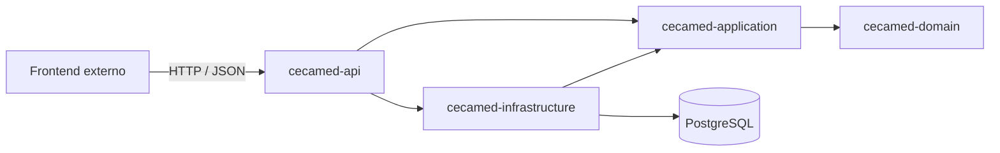

# CECAMed Backend

Backend independiente para migrar CECAMed de escritorio a una aplicación web.
Esta entrega corresponde únicamente a la arquitectura inicial; las funcionalidades
clínicas se incorporarán por etapas. No contiene frontend ni dependencias de JavaFX.

## Stack

- Java 21.
- Spring Boot 4.1.1 y Spring MVC.
- Gradle 9.7.1 con Kotlin DSL y wrapper incluido.
- Spring Data JPA, PostgreSQL 16 y Flyway.
- Spring Security, Bean Validation, Actuator y OpenAPI con springdoc 3.1.1.
- JUnit y MockMvc; H2 solo para comprobar el contexto de pruebas.

Se utiliza Spring Boot 4 para una base nueva, independiente del Spring Boot 3.3.4
del escritorio. La compatibilidad de Java y Gradle se puede consultar en los
[requisitos oficiales](https://docs.spring.io/spring-boot/system-requirements.html).
La integración OpenAPI sigue la [documentación de springdoc](https://springdoc.org/).

## Arquitectura

Monolito modular con puertos y adaptadores, desplegado como un único JAR.
Los módulos Gradle establecen las dependencias entre capas; dentro de cada módulo,
los paquetes se organizarán por funcionalidad al incorporarla.

```text
CECAMed-backend/
├── cecamed-domain/           # Modelo y reglas de negocio, Java puro
├── cecamed-application/      # Casos de uso y contratos de puertos
├── cecamed-infrastructure/   # JPA, migraciones, archivos e integraciones
├── cecamed-api/              # Spring Boot, REST, seguridad y contrato OpenAPI
├── docs/
│   ├── architecture.md      # Límites, decisiones y plan de migración
│   └── api-contract.md      # Guía de integración para el frontend
├── gradle/wrapper/
├── compose.yaml             # PostgreSQL local independiente
└── .env.example
```



La API incorpora infraestructura para componer la aplicación. Los controladores
de negocio utilizarán los puertos de entrada de aplicación, sin llamar repositorios.
Las reglas y el proceso de incorporación de funcionalidades están en
[architecture.md](docs/architecture.md).

## Arranque local

Requiere JDK 21, Docker Compose y conexión a Internet para la primera descarga.
No es necesario instalar Gradle. Ejecutar desde la raíz de este proyecto:

```bash
cp .env.example .env
# Editar DB_PASSWORD antes de iniciar PostgreSQL.
docker compose up -d --wait postgres
./gradlew :cecamed-api:bootRun
```

El perfil predeterminado es `local`. Solo este perfil importa `.env` como propiedades
desde la raíz. Las variables exportadas en el entorno tienen prioridad. En el IDE,
seleccionar JDK 21 y usar la raíz de este proyecto como directorio de trabajo.
En Windows, utilizar `gradlew.bat`.

La API escucha en `http://127.0.0.1:8080` y PostgreSQL publica el puerto `5433`.
Para conectar desde otro equipo, configurar `SERVER_ADDRESS` y el origen CORS.
La URL local se construye con `DB_HOST`, `DB_PORT` y `DB_NAME`. Si se proporciona
`DB_URL`, se utiliza esa URL completa en lugar de construirla.

| Recurso | Dirección local |
| --- | --- |
| Información de versión | `GET /api/v1/system/info` |
| Estado del servicio | `GET /actuator/health` |
| Disponibilidad con base de datos | `GET /actuator/health/readiness` |
| Estado del proceso | `GET /actuator/health/liveness` |
| Contrato OpenAPI JSON | `GET /v3/api-docs` |
| Documentación interactiva | `/swagger-ui/index.html` |

La documentación interactiva está incluida en el backend para explorar la API.
Los contratos y ejemplos de integración están en [api-contract.md](docs/api-contract.md).

```bash
curl http://localhost:8080/api/v1/system/info
curl http://localhost:8080/actuator/health
```

## Configuración

| Variable | Uso |
| --- | --- |
| `DB_URL` | URL JDBC opcional en local y obligatoria en producción. Prevalece sobre host, puerto y nombre. |
| `DB_HOST` | Host de la conexión local; predeterminado `localhost`. |
| `DB_NAME` | Base que crea Compose y nombre usado para construir la URL local; predeterminado `cecamed_backend`. |
| `DB_USERNAME` / `DB_PASSWORD` | Credenciales de PostgreSQL. |
| `DB_PORT` | Puerto local que publica Compose; predeterminado `5433`. |
| `SERVER_PORT` | Puerto HTTP; predeterminado `8080`. |
| `SERVER_ADDRESS` | Dirección de escucha; en local `127.0.0.1`. |
| `CORS_ALLOWED_ORIGINS` | Orígenes del frontend separados por comas, sin barra final. |
| `SPRING_PROFILES_ACTIVE` | `local` o `prod`; predeterminado `local`. |

El perfil `prod` exige `DB_URL`, `DB_USERNAME` y `DB_PASSWORD` mediante el entorno
o configuración externa; no carga `.env`. Desactiva OpenAPI/Swagger y no
autoriza orígenes CORS salvo los configurados. Activarlo con `SPRING_PROFILES_ACTIVE=prod`
sin combinarlo con `local`. Si se define `DB_URL` en local, su base y puerto deben
coincidir con los de Compose. La autenticación web todavía no está
implementada: Spring Security bloquea todas las rutas salvo los recursos técnicos
indicados. No existen usuarios ni contraseñas de aplicación predefinidos.

## Compilación y comprobaciones

```bash
./gradlew build
./gradlew :cecamed-api:test
java -jar cecamed-api/build/libs/cecamed-backend.jar
```

Las pruebas normales cubren arranque de contexto, contrato OpenAPI, errores HTTP,
validación de entradas, bloqueo de rutas, CORS, separación de perfiles y reloj UTC.
Usan H2 con Flyway desactivado y no requieren PostgreSQL.
Los informes se generan en `cecamed-api/build/reports/tests/test/index.html`.

Para verificar PostgreSQL y Flyway se utiliza una base desechable independiente,
sin el volumen ni las credenciales de desarrollo:

```bash
docker compose -f compose.test.yaml up -d --wait
TEST_DB_URL=jdbc:postgresql://localhost:5434/cecamed_test \
TEST_DB_USERNAME=cecamed_test TEST_DB_PASSWORD=test-only \
./gradlew :cecamed-api:postgresTest
docker compose -f compose.test.yaml down
```

La tarea `postgresTest` exige las tres variables `TEST_DB_*`; nunca recurre a `DB_*`.
Usa el perfil `prod` con una conexión de prueba y comprueba la creación del esquema
y del historial Flyway, la repetición de la migración sin cambios, la zona UTC de
la conexión y la conservación de instantes en `TIMESTAMPTZ`. Sus informes están en
`cecamed-api/build/reports/tests/postgresTest/index.html`. Ejecutar esta tarea también
en CI con una base aislada. Los datos de `compose.test.yaml` se descartan al detenerla.

## Base de datos y alcance de esta etapa

Se mantienen las tecnologías de persistencia del CECAMed original, con una base
y un volumen nuevos. Flyway es el único responsable de evolucionar el esquema;
Hibernate utiliza `ddl-auto=validate`. Aún no existen tablas de negocio ni
migraciones SQL versionadas. Flyway preparará su esquema e historial al arrancar.
La validación de migraciones y de sus nombres está habilitada; `clean` y el
baseline automático están deshabilitados. La inicialización mediante `schema.sql`
o `data.sql` también está deshabilitada para que Flyway sea el único responsable.

El servidor PostgreSQL de Compose y cada conexión del pool usan UTC, igual que
Hibernate y el bean inyectable `Clock`. Para obtener el instante actual se debe
usar `Instant.now(clock)`; las fechas civiles continúan siendo `LocalDate`. La
conversión para mostrar horarios de la clínica usará `America/Guatemala`.

La entrega incluye módulos, configuración, manejo uniforme de errores, CORS,
seguridad restrictiva, OpenAPI, información de versión y salud del servicio.
Quedan para siguientes etapas la autenticación y roles, pacientes, expedientes,
consultas, citas, recepción, documentos, inventario y Google Calendar.
El código y los datos de `../CECAMed` no se modifican ni se copian automáticamente.

Para detener la base conservando sus datos:

```bash
docker compose down
```
