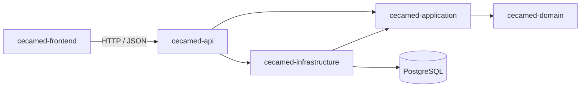

# CECAMed Backend

Backend independiente para migrar CECAMed de escritorio a una aplicación web.
Incluye el frontend web en `cecamed-frontend`, identidad y acceso, pacientes,
expediente y consultas básicas persistidas. El incremento 1 integra el recorrido
login → paciente → expediente → consulta con control de versiones y sesión con
refresh. No depende de JavaFX. El estado revisado y los siguientes incrementos
están en [PLAN.md](PLAN.md).

## Stack

- Java 21.
- Spring Boot 4.1.1 y Spring MVC.
- Gradle 9.7.1 con Kotlin DSL y wrapper incluido.
- Spring Data JPA, PostgreSQL 16 y Flyway.
- Spring Security, Bean Validation, Actuator y OpenAPI con springdoc 3.1.1.
- JUnit y MockMvc; H2 solo para comprobar el contexto de pruebas.

Se utiliza Spring Boot 4 para una base nueva, independiente del Spring Boot 3.3.4
del escritorio. La compatibilidad de Java y Gradle se puede consultar en los
[requisitos oficiales](https://docs.spring.io/spring-boot/system-requirements.html).
La integración OpenAPI sigue la [documentación de springdoc](https://springdoc.org/).

## Arquitectura

Monolito modular con puertos y adaptadores, desplegado como un único JAR.
Los módulos Gradle establecen las dependencias entre capas; dentro de cada módulo,
los paquetes se organizarán por funcionalidad al incorporarla.

```text
CECAMed-backend/
├── cecamed-domain/           # Modelo y reglas de negocio, Java puro
├── cecamed-application/      # Casos de uso y contratos de puertos
├── cecamed-infrastructure/   # JPA, migraciones, archivos e integraciones
├── cecamed-api/              # Spring Boot, REST, seguridad y contrato OpenAPI
├── cecamed-frontend/         # Frontend web: React, TypeScript y Vite
├── docs/
│   ├── architecture.md      # Límites, decisiones y plan de migración
│   ├── api-contract.md      # Guía de integración para el frontend
│   └── frontend.md          # Arquitectura y decisiones del frontend
├── gradle/wrapper/
├── compose.yaml             # PostgreSQL local independiente
└── .env.example
```



La API incorpora infraestructura para componer la aplicación. Los controladores
de negocio utilizarán los puertos de entrada de aplicación, sin llamar repositorios.
Las reglas y el proceso de incorporación de funcionalidades están en
[architecture.md](docs/architecture.md).

## Arranque local

Requiere JDK 21, Docker Compose y conexión a Internet para la primera descarga.
No es necesario instalar Gradle. Ejecutar desde la raíz de este proyecto:

```bash
cp .env.example .env
# Editar DB_PASSWORD antes de iniciar PostgreSQL.
docker compose up -d --wait postgres
./gradlew :cecamed-api:bootRun
```

El perfil predeterminado es `local`. Solo este perfil importa `.env` como propiedades
desde la raíz. Las variables exportadas en el entorno tienen prioridad. En el IDE,
seleccionar JDK 21 y usar la raíz de este proyecto como directorio de trabajo.
En Windows, utilizar `gradlew.bat`.

La API escucha en `http://127.0.0.1:8080` y PostgreSQL publica el puerto `5433`.
Para conectar desde otro equipo, configurar `SERVER_ADDRESS` y el origen CORS.
La URL local se construye con `DB_HOST`, `DB_PORT` y `DB_NAME`. Si se proporciona
`DB_URL`, se utiliza esa URL completa en lugar de construirla.

| Recurso | Método | Dirección local | Acceso |
| --- | --- | --- | --- |
| Información de versión | GET | `/api/v1/system/info` | Público |
| Estado del servicio | GET | `/actuator/health` | Público |
| Disponibilidad con base de datos | GET | `/actuator/health/readiness` | Público |
| Estado del proceso | GET | `/actuator/health/liveness` | Público |
| Contrato OpenAPI JSON | GET | `/v3/api-docs` | Público en perfil local |
| Documentación interactiva | GET | `/swagger-ui/index.html` | Público en perfil local |
| Inicio de sesión | POST | `/api/v1/auth/login` | Público |
| Refresco de tokens | POST | `/api/v1/auth/refresh` | Público |
| Cierre de sesión | POST | `/api/v1/auth/logout` | Público |
| Usuario autenticado | GET | `/api/v1/auth/me` | Autenticado (`MEDICO`, `RECEPCION`, `ADMIN`) |
| Gestión de usuarios | * | `/api/v1/users/**` | Exclusivo `ADMIN` |
| Pacientes administrativos | * | `/api/v1/patients`, `/api/v1/patients/{id}` y cambios de estado | `MEDICO` o `RECEPCION` |
| Expediente y consultas | * | `/api/v1/patients/{id}/medical-record`, `/api/v1/patients/{id}/consultations/**` | Solo `MEDICO` |

La documentación interactiva está incluida en el backend para explorar la API.
Los contratos y ejemplos de integración están en [api-contract.md](docs/api-contract.md).

```bash
curl http://localhost:8080/api/v1/system/info
curl http://localhost:8080/actuator/health
```

## Frontend

La interfaz web reemplaza las pantallas JavaFX y vive en `cecamed-frontend/`. Se
desarrolla con Node.js 20 o superior, independiente de Gradle:

```bash
cd cecamed-frontend
npm ci
npm run dev        # contra esta API en :8080, en http://localhost:5173
npm run dev:mock   # con API simulada, sin backend
```

En desarrollo, Vite reenvía `/api` al backend, así que no hace falta configurar CORS.
Pacientes, expediente y consultas básicas consumen la API real.
`npm run dev:mock` permite explorar también las pantallas pendientes con datos de ejemplo (`medico` / `medico123`, `recepcion` / `recepcion123`).

| Documento | Contenido |
| --- | --- |
| [cecamed-frontend/README.md](cecamed-frontend/README.md) | Ejecución, scripts y estructura |
| [docs/frontend.md](docs/frontend.md) | Arquitectura, sesión, fechas, apariencia y pendientes |
| [contrato-api-esperado.md](cecamed-frontend/docs/contrato-api-esperado.md) | Rutas y DTO que el frontend necesita de esta API |

## Configuración

| Variable | Uso |
| --- | --- |
| `DB_URL` | URL JDBC opcional en local y obligatoria en producción. Prevalece sobre host, puerto y nombre. |
| `DB_HOST` | Host de la conexión local; predeterminado `localhost`. |
| `DB_NAME` | Base que crea Compose y nombre usado para construir la URL local; predeterminado `cecamed_backend`. |
| `DB_USERNAME` / `DB_PASSWORD` | Credenciales de PostgreSQL. |
| `DB_PORT` | Puerto local que publica Compose; predeterminado `5433`. |
| `SERVER_PORT` | Puerto HTTP; predeterminado `8080`. |
| `SERVER_ADDRESS` | Dirección de escucha; en local `127.0.0.1`. |
| `CORS_ALLOWED_ORIGINS` | Orígenes del frontend separados por comas, sin barra final. |
| `SPRING_PROFILES_ACTIVE` | `local` o `prod`; predeterminado `local`. |
| `JWT_SECRET` | Clave HMAC-SHA256 para firma de JWT (mínimo 32 caracteres / 256 bits). Obligatoria en `prod`. |
| `JWT_ACCESS_TOKEN_EXPIRATION_MINUTES` | Duración del token de acceso; predeterminado `15`. |
| `JWT_REFRESH_TOKEN_EXPIRATION_DAYS` | Duración del refresh token; predeterminado `7`. |
| `BRUTE_FORCE_MAX_ATTEMPTS` | Intentos fallidos antes de bloqueo temporal; predeterminado `5`. |
| `BRUTE_FORCE_LOCKOUT_MINUTES` | Duración del bloqueo temporal en minutos; predeterminado `15`. |
| `BOOTSTRAP_ADMIN_USERNAME` | Usuario del administrador inicial. Si no se define junto a la contraseña, no se crea. |
| `BOOTSTRAP_ADMIN_PASSWORD` | Contraseña del administrador inicial (mínimo 12 caracteres). |
| `BOOTSTRAP_ADMIN_FULL_NAME` | Nombre completo del administrador inicial; predeterminado `Administrador Inicial`. |

El perfil `prod` exige `DB_URL`, `DB_USERNAME`, `DB_PASSWORD` y `JWT_SECRET` mediante el entorno
o configuración externa; no carga `.env`. Desactiva OpenAPI/Swagger y no
autoriza orígenes CORS salvo los configurados. Activarlo con `SPRING_PROFILES_ACTIVE=prod`
sin combinarlo con `local`.

### Modelo de Seguridad (Fase 2: Identidad y Acceso)

- **Autenticación Bearer Stateless**: El cliente envía `Authorization: Bearer <accessToken>` en cada solicitud protegida. No se crean sesiones HTTP ni se utilizan cookies. CSRF está deshabilitado justificadamente bajo este modelo.
- **Tokens**:
  - **Access Token**: JWT HMAC-SHA256 de vida corta (15 min) que transporta identidad (`sub`), rol (`role`), nombre completo (`fullName`) e identificador.
  - **Refresh Token**: Token opaco criptográfico de vida más larga (7 días) cuyo hash SHA-256 se almacena en base de datos.
  - **Rotación estricta y detección de reuso**: Cada llamada a `/api/v1/auth/refresh` revoca el refresh token actual y emite un nuevo par. Si un refresh token revocado es presentado nuevamente, se detecta un posible robo de sesión, se invalidan de inmediato todas las sesiones activas del usuario y se registra una alerta de seguridad.
  - **Cierre de sesión (`/api/v1/auth/logout`)**: Revoca el refresh token para impedir su reutilización.
- **Roles**:
  - `MEDICO`: Acceso a rutas clínicas y consultas.
  - `RECEPCION`: Acceso a recepción, citas y expedientes administrativos.
  - `ADMIN`: Acceso exclusivo a la gestión de cuentas de usuario (`/api/v1/users/**`).
- **Protección contra fuerza bruta**: Tras 5 intentos fallidos consecutivos de inicio de sesión, la cuenta se bloquea temporalmente por 15 minutos. El mensaje de error es genérico (`Credenciales incorrectas`) para evitar la enumeración de cuentas existentes.
- **Auditoría de seguridad**: Se registran en base de datos todos los eventos de autenticación (`LOGIN_SUCCESS`, `LOGIN_FAILED`, `TOKEN_REFRESH`, `REFRESH_TOKEN_REUSE_DETECTED`, `LOGOUT`, `ACCOUNT_LOCKED`, `USER_CREATED`, etc.) con timestamp UTC, dirección IP y User-Agent, garantizando la persistencia mediante transacciones independientes (`REQUIRES_NEW`) sin registrar jamás secretos ni contraseñas.
- **Bootstrap Seguro**: Para crear el primer administrador, configure `BOOTSTRAP_ADMIN_USERNAME` y `BOOTSTRAP_ADMIN_PASSWORD` en el entorno. No existen usuarios predeterminados hardcodeados.


## Compilación y comprobaciones

```bash
./gradlew build
./gradlew :cecamed-api:test
java -jar cecamed-api/build/libs/cecamed-backend.jar
```

Las pruebas normales cubren arranque de contexto, contrato OpenAPI, errores HTTP,
validación de entradas, bloqueo de rutas, CORS, separación de perfiles y reloj UTC.
También ejecutan el flujo clínico con persistencia, auditoría, versiones obsoletas,
escrituras simultáneas, permisos y ciclo de sesión.
Usan H2 con Flyway desactivado y no requieren PostgreSQL.
Los informes se generan en `cecamed-api/build/reports/tests/test/index.html`.

Para verificar PostgreSQL y Flyway se utiliza una base desechable independiente,
sin el volumen ni las credenciales de desarrollo:

```bash
docker compose -f compose.test.yaml up -d --wait
TEST_DB_URL=jdbc:postgresql://localhost:5434/cecamed_test \
TEST_DB_USERNAME=cecamed_test TEST_DB_PASSWORD=test-only \
./gradlew :cecamed-api:postgresTest
docker compose -f compose.test.yaml down
```

La tarea `postgresTest` exige las tres variables `TEST_DB_*`; nunca recurre a `DB_*`.
Usa el perfil `prod` con una conexión de prueba y comprueba la creación del esquema
y del historial Flyway, la repetición de la migración sin cambios, la zona UTC de
la conexión y la conservación de instantes en `TIMESTAMPTZ`. Sus informes están en
`cecamed-api/build/reports/tests/postgresTest/index.html`. Ejecutar esta tarea también
en CI con una base aislada. Los datos de `compose.test.yaml` se descartan al detenerla.

## Base de datos y alcance de esta etapa

Se mantienen las tecnologías de persistencia del CECAMed original, con una base
y un volumen nuevos. Flyway es el único responsable de evolucionar el esquema;
Hibernate utiliza `ddl-auto=validate`. Las migraciones V1–V5 crean identidad,
auditoría, pacientes, consultas y expedientes y estabilizan sus datos. Consultar la
[secuencia de migraciones](cecamed-infrastructure/src/main/resources/db/migration/README.md)
antes de actualizar una base existente.
La validación de migraciones y de sus nombres está habilitada; `clean` y el
baseline automático están deshabilitados. La inicialización mediante `schema.sql`
o `data.sql` también está deshabilitada para que Flyway sea el único responsable.

El servidor PostgreSQL de Compose y cada conexión del pool usan UTC, igual que
Hibernate y el bean inyectable `Clock`. Para obtener el instante actual se debe
usar `Instant.now(clock)`; las fechas civiles continúan siendo `LocalDate`. La
conversión para mostrar horarios de la clínica usará `America/Guatemala`.

La entrega incluye módulos, configuración, manejo uniforme de errores, CORS,
autenticación Bearer, roles, OpenAPI, información de versión y salud del servicio.
Pacientes, expedientes y consultas básicas tienen un contrato integrado y probado.
Firma/enmiendas, documentos, citas, recepción, horarios, inventario, reportes y
Google Calendar no forman parte de esta entrega. Existen cambios sin commit de
otras ramas para varias de esas áreas; requieren su propia integración y aceptación.
El código y los datos de `../CECAMed` no se modifican ni se copian automáticamente.

Para detener la base conservando sus datos:

```bash
docker compose down
```

## Frontend y verificación del incremento 1

```bash
cd cecamed-frontend
npm ci
npm test
npm run build
npm run dev
```

El cliente usa `/api/v1` mediante el proxy de Vite. MEDICO y RECEPCION entran a
pacientes; ADMIN entra a configuración y conserva la administración de usuarios
por API. Los tokens se guardan en `sessionStorage`; los 401 de rutas protegidas
rotan el refresh una sola vez y reintentan la petición. Login/refresh/logout no
envían un Bearer expirado. Logout revoca el último refresh y borra la sesión local.

Para probar manualmente: crear un usuario MEDICO con el ADMIN inicial mediante
`POST /api/v1/users`, iniciar sesión, registrar un paciente, abrir su expediente,
guardar antecedentes, registrar una consulta y editarla. Una edición obsoleta
responde 409; recargar los datos antes de volver a guardar. Las fechas de creación
y consulta las asigna el servidor. La fecha de nacimiento admite el día actual
según Guatemala. Consultar [el contrato](docs/api-contract.md).

Validación local (2026-10-18): 103 pruebas normales, 8 pruebas PostgreSQL y
4 pruebas de sesión frontend aprobadas; compilaciones real y simulada aprobadas.
Gradle build y contrato clínico sobre PostgreSQL 18.6 desechable,
con Flyway desde una base vacía y repetición sin migraciones pendientes. El perfil
normal usa H2; no sustituye las pruebas PostgreSQL. Compose conserva PostgreSQL 16
para validación en CI. No se ha realizado una aceptación visual completa en navegador.
