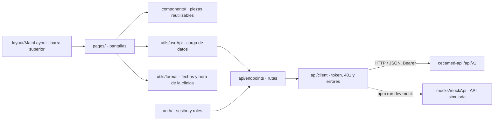

# Frontend web de CECAMed

El frontend reemplaza la interfaz de escritorio JavaFX del CECAMed original por una
aplicación web de una sola página. Vive en `cecamed-frontend/`, está hecho con React 18,
TypeScript y Vite, y consume la API REST de `cecamed-api` bajo `/api/v1`.

Este documento explica cómo está organizado y qué decisiones se tomaron. Para ejecutarlo,
ver [cecamed-frontend/README.md](../cecamed-frontend/README.md). Las rutas que necesita del
backend están en [contrato-api-esperado.md](../cecamed-frontend/docs/contrato-api-esperado.md).

## Stack

| Tecnología | Versión | Uso |
| --- | --- | --- |
| React | 18.3.1 | Componentes de la interfaz |
| TypeScript | 5.6.3 | Tipos en modo estricto (`strict`, `noUnusedLocals`, `noUnusedParameters`) |
| Vite | 6.4.3 | Servidor de desarrollo, proxy `/api` y compilación a `dist/` |
| React Router | 7.18.4 | Navegación entre pantallas sin recargar la página |
| lucide-react | 0.460.0 | Íconos |
| Atkinson Hyperlegible Next | 5.3.0 | Tipografía de alta legibilidad |

Las versiones están fijadas en `package.json` y `package-lock.json`. Se instalan con
`npm ci` para que todo el equipo use exactamente las mismas. `npm audit` reporta 0
vulnerabilidades.

## Arquitectura



Las pantallas no llaman a `fetch` directamente. Toda petición pasa por `api/client.ts`,
que es el único lugar que conoce el token, los errores y la URL base. Así un cambio en el
backend se corrige en un solo archivo.

| Carpeta | Responsabilidad |
| --- | --- |
| `src/api/` | `client.ts` (envío, token, 401, Problem Details), `endpoints.ts` (una función por ruta), `types.ts` (DTO) |
| `src/auth/` | `AuthContext` (sesión) y `RequireAuth` / `RequireRole` (guardas de ruta) |
| `src/components/` | Modal, confirmación, notificaciones, insignias de estado, tarjetas de indicadores, marca |
| `src/layout/` | Barra superior con navegación, usuario, tema y línea de estado con el reloj |
| `src/pages/` | Una pantalla por vista de escritorio |
| `src/theme/` | Tema claro u oscuro |
| `src/utils/` | Fechas en hora de la clínica, etiquetas en español y hooks |
| `src/mocks/` | API simulada; solo se carga en modo mock |
| `src/styles.css` | Variables de color, tipografía y estilos de todas las pantallas |

## Equivalencias con JavaFX

| JavaFX | Web | Ruta |
| --- | --- | --- |
| `login.fxml` | `pages/LoginPage.tsx` | `/login` |
| `main-layout.fxml` | `layout/MainLayout.tsx` | — |
| `dashboard.fxml` | `pages/DashboardPage.tsx` | `/` |
| `patient-list.fxml`, `patient-form-dialog.fxml` | `pages/PatientsPage.tsx`, `pages/PatientFormModal.tsx` | `/pacientes` |
| `medical-record.fxml` | `pages/MedicalRecordPage.tsx`, `pages/DocumentsTab.tsx` | `/expediente/:patientId` |
| `appointment-calendar.fxml`, `appointment-dialog.fxml` | `pages/AppointmentsPage.tsx`, `pages/AppointmentFormModal.tsx` | `/agenda` |
| `reception.fxml` | `pages/ReceptionPage.tsx` | `/recepcion` |
| `settings.fxml` | `pages/SettingsPage.tsx` | `/configuracion` |
| `NavigationService`, `ViewType` | `App.tsx` con React Router | — |
| `UserSession`, `AuthenticationService` | `auth/AuthContext.tsx` | — |
| `ThemeManager` | `theme/ThemeContext.tsx` | — |
| `NotificationService`, `ConfirmationDialog` | `components/Toast.tsx`, `components/ConfirmDialog.tsx` | — |
| `javafx.concurrent.Task` | `utils/useApi.ts` | — |

## Sesión y permisos

1. `LoginPage` envía usuario y contraseña a `POST /auth/login` y recibe un token.
2. El token se guarda en `sessionStorage`, que se borra al cerrar la pestaña. En un equipo
   compartido de la clínica, la sesión no queda abierta para la siguiente persona.
3. Cada petición lo envía como `Authorization: Bearer <token>`. El backend es stateless y
   no usa cookies.
4. Si cualquier respuesta es 401, el cliente borra el token y emite un evento. `AuthContext`
   cierra la sesión y la pantalla de acceso avisa que expiró. Esto incluye la descarga de
   documentos, que usa `requestBlob` del mismo cliente.

Todas las rutas, salvo `/login`, están dentro de `RequireAuth`. El expediente clínico está
además dentro de `RequireRole` con el rol `MEDICO`; el menú lo oculta para `RECEPCION`.
El frontend solo oculta: **el backend debe validar los permisos** en cada ruta. La
autenticación y los roles todavía no existen en `cecamed-api`, y el alcance del rol de
administración que menciona `architecture.md` está por definir.

## Comunicación con la API

- **Cabeceras:** solo `Authorization`, `Content-Type` y `Accept`, las que permite el CORS
  del backend.
- **Errores:** el backend responde *Problem Details* (`detail`, `code`, `errors[]`). El
  cliente lanza `ApiError` con `status` y `code`; muestra `detail` o, en validaciones, los
  mensajes de `errors[]`. Las decisiones se toman por `code`, que es estable.
- **Sin conexión:** se muestra que el backend no está en ejecución.
- **Proxy:** en desarrollo, Vite reenvía `/api` a `http://localhost:8080` (o a
  `CECAMED_API_URL`), así que no se necesita CORS.

## Fechas y zona horaria

`docs/api-contract.md` pide instantes ISO 8601 con offset y `architecture.md` fija la zona
de la clínica, `America/Guatemala`. El frontend trabaja así:

| Caso | Comportamiento |
| --- | --- |
| Recibir un instante (`…Z` o `…-06:00`) | Se convierte y se muestra en hora de Guatemala |
| Enviar fecha y hora (citas, consultas, bloqueos) | `2026-10-15T09:30:00-06:00` |
| Filtros de la agenda y recepción | Inicio y fin del día de la clínica, con offset |
| "Ahora" (reloj, hoy, horarios pasados) | `clinicNow()`, nunca `new Date()` |
| Fechas de calendario (nacimiento) | `YYYY-MM-DD`, sin hora |

Toda la conversión está en `src/utils/format.ts`. Un equipo configurado en UTC o en otro
país muestra 09:30 igual que uno en Guatemala.

## Carga de datos

`useApi` hace una petición al abrir una pantalla y entrega datos, estado de carga y error.
Si el usuario sale antes de la respuesta, cancela la petición con `AbortController`.

Cada sección se carga de forma independiente. En el expediente, paciente, antecedentes,
consultas, historial de citas y documentos son peticiones separadas: si una ruta todavía
no existe, solo esa pestaña muestra el error. Recepción se refresca cada minuto y, después
de medianoche, pasa sola al día nuevo.

La sala de espera calcula el tiempo con `checkedInAt`, la hora de llegada que registra el
backend al pasar una cita a `EN_SALA`. No usa `updatedAt`, porque cualquier otro cambio de
la cita lo modifica.

## Apariencia

Los colores siguen las reglas de la versión de escritorio (`theme-light.css` y
`theme-dark.css` del CECAMed original). Están definidos una sola vez como variables CSS
en `styles.css`; el tema oscuro solo cambia esas variables.

| Uso | Claro | Oscuro |
| --- | --- | --- |
| Marca y acción principal | `#D32F2F` | `#E53935` |
| Acción secundaria y selección | `#0288D1` | `#0288D1` |
| Fondo / superficie | `#F8FAFC` / `#FFFFFF` | `#0F172A` / `#1E293B` |

Los estados de cita usan verde (atendida, confirmada), amarillo (en sala), rojo (cancelada)
y celeste (programada). La navegación está en una barra superior; el contenido llega hasta
1840 px de ancho en monitores grandes y se adapta a celular.

## API simulada

`npm run dev:mock` activa `src/mocks/mockApi.ts`, que intercepta `fetch` en el navegador y
responde con datos de ejemplo, con las mismas rutas y formatos del contrato. Se carga con
una importación dinámica, así que no entra en `npm run build`. Datos que replica del
contrato: instantes con offset, `checkedInAt`, 409 al reservar un horario ocupado y
`/system/info` público. Usuarios: `medico` / `medico123` y `recepcion` / `recepcion123`.

La simulación sirve para probar la interfaz, **no demuestra que el backend cumpla el
contrato**. Ese archivo todavía tiene desactivada la comprobación de tipos
(`@ts-nocheck`).

## Ejecución y despliegue

```powershell
cd cecamed-frontend
npm ci              # librerías, la primera vez o si cambia package.json
npm run dev:mock    # con API simulada -> http://localhost:5173
npm run dev         # con cecamed-api en :8080
npm run build       # revisa tipos y genera dist/
```

`dist/` son archivos estáticos que se pueden servir desde Nginx o desde el propio Spring
Boot. El servidor debe responder `index.html` para cualquier ruta del cliente. Si el
frontend y la API quedan en dominios distintos, se compila con
`VITE_API_BASE_URL=https://dominio/api/v1` y se agrega el dominio del frontend a
`CORS_ALLOWED_ORIGINS` del backend.

## Pendientes

| Pendiente | Responsable |
| --- | --- |
| Endpoints de negocio del contrato | Backend |
| Login, validación de tokens y roles | Backend |
| Campo `checkedInAt` en citas | Backend |
| Separar DTO de solicitud y respuesta; acordar campos obligatorios, nulos y calculados | Backend y frontend |
| Quitar `filePath` de `PatientDocument` en la respuesta | Backend |
| Tipar la API simulada (quitar `@ts-nocheck`) | Frontend |
